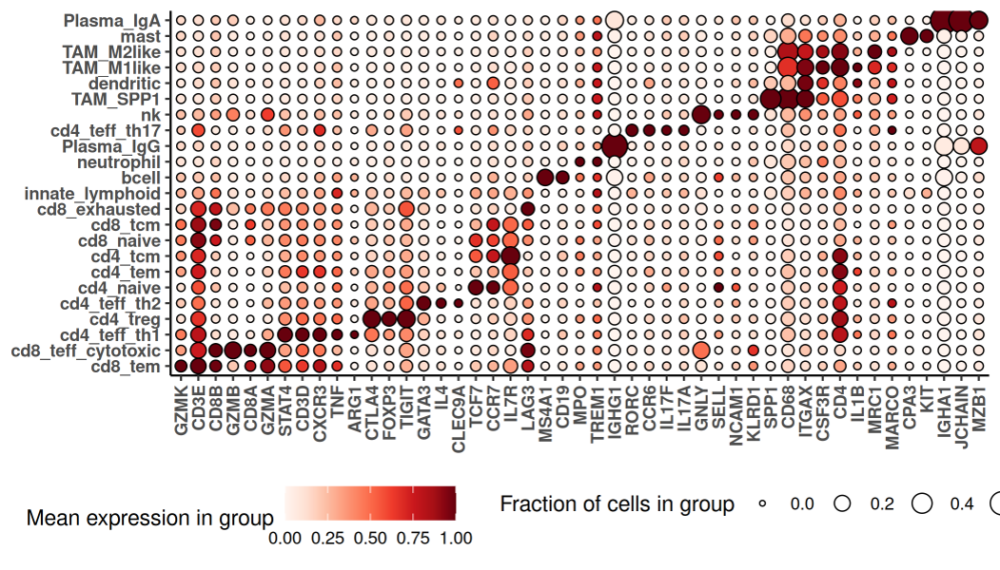

# Introduction

We recently published an intensive analysis of an early CosMx (R) WTX dataset in which we sought to assess the depth of insight that could be wrung from a single sample.
We believe the resulting analyses hold useful lessons and serve as a template for other spatial projects. 
Here we share relevant insights from this exercise. 

Relevant links:

- The full manuscript: [(Williams et al 2026)](https://www.nature.com/articles/s41598-026-69141-x)
- Code and data: [Zenodo](https://zenodo.org/records/18943070); [github](https://nanostring-biostats.github.io/CosMxWTx_BreastCancerAnalysis/)


# Best practice workflows worked, and customization improved on them

As with any project, we began with QC, dimension reduction, and cell typing. 
For these steps we relied on the standard tools recommended throughout the scratch space and 
 demonstrated in our [basic analysis vignette](https://nanostring-biostats.github.io/CosMx-Analysis-Scratch-Space/posts/vignette-basic-analysis-updated/01_preprocessing.html) and [analysis guide](https://nanostring-biostats.github.io/CosMx-Analysis-Scratch-Space/guides/the-wtx-guide/):

- Removing cells with low counts or extremely high areas
- [FOV QC](https://nanostring-biostats.github.io/CosMx-Analysis-Scratch-Space/posts/fov-qc/) (no FOVs were flagged in this study)
- Dimension reduction (we now recommend [scPearsonPCA](https://nanostring-biostats.github.io/CosMx-Analysis-Scratch-Space/posts/pearsonpca/)), followed by Louvain or Leiden clustering
- Immune cell typing with [HieraType](https://nanostring-biostats.github.io/CosMx-Analysis-Scratch-Space/posts/immune-cell-typing-smooth/)
- Niche / spatial domain detection the Novae algorithm. (A CosMx-retrained Novae algorithm is available on AtoMx.)
- Pathway scoring with the REACTOME database and the AUCell algorithm

As we've seen in other studies, these methods produced a nuanced and satisfying cell typing result,
 including 23 immune populations and 11 T-cell subsets:
 
```{r}
#| eval: true
#| echo: false


```

We also found it useful to lightly extend the standard workflow.
Namely, to better understand the cancer's diversity, we performed a second-stage subclustering of cancer cells,
re-running HVG selection, PCA and clustering within cancer cells. 
(Another recommendation beyond the paper's methods: to avoid bias from segmentation errors, subclustering exercises liek this should use cancer-relevant genes identified by the [smiDE package's overlapratiometric function](https://github.com/Nanostring-Biostats/CosMx-Analysis-Scratch-Space/blob/Main/_code/smiDE/R/pre_de_contamination_screen.R).)

 
 
Beyond enabling targeted analyses that followed, these preliminary analyses produced some useful results. 
Our final figures includes descriptions of the expression profiles of certain cell clusters:

```{r}
#| eval: true
#| echo: false

knitr::include_graphics("./figures/tumormarkers.png", out.width = "140%")
```

...and of pathway enrichment in niches:

```{r}
#| eval: true
#| echo: false

knitr::include_graphics("./figures/nichepathways.png", out.width = "140%")
```

...and of the concentrations of T-cell subpopulations in different niches:

```{r}
#| eval: true
#| echo: false

knitr::include_graphics("./figures/tcelllocations.png", out.width = "140%")
```


# Differential expression was the analytical workhorse

The above results were revealing, but they only gave us a high-level summary of the sample. 
As we sought to more fully understand this tumor, we found ourselves turning again and again to differential expression (DE).
More specifically, we invariably found that our biological questions were best framed as DE problems. 
The approaches we took could all have been taken from [our overview of DE tools](https://nanostring-biostats.github.io/CosMx-Analysis-Scratch-Space/posts/vignette-basic-analysis-updated/03_DE.html). 
We review them here to demonstrate the versatility of DE as a tool of biological inquiry and the expansiveness of the results it provides. 

### Contrasting cancer cells across regions of interest

The tumor's immunofluorescence image showed two morphologically distinct lobes, with 
 stroma between them: 

```{r}
#| eval: true
#| echo: false

knitr::include_graphics("./figures/lobes.png", out.width = "125%")
```

To understand the functional difference between these lobes, we ran DE comparing tumor cells in 
 the "dense" vs. "interdigitated" regions. 
An overwhelming abundance of significant single-gene results was made intelligible via pathway analysis:

```{r}
#| eval: true
#| echo: false

knitr::include_graphics("./figures/lobeDE.png", out.width = "125%")
```


### Contrasting T cell behavior across spatial domains

This cancer was highly T-cell infiltrated. To understand how it kept the immune response in check, 
 we used DE to compare cytotoxic CD8 cell profiles across 3 spatial contexts defined by Novae niches: niches from the "exterior stroma" surrounding the tumor, niches from the "interior stroma" interdigitating the tumor, and niches from the dense "tumor bed". 
 
T-cell locations and spatial contexts looked like this:

```{r}
#| eval: true
#| echo: false

knitr::include_graphics("./figures/Tcellxy.png", out.width = "140%")
```

Importantly, to avoid artifacts from segmentation errors, we again used smiDE's `overlapratiometric` function to 
 remove the most at-risk genes, resulting in 8954 genes deemed safe for DE in this T-cell population. 

This DE exercise across 3 categories produced 435 genes meeting adjusted p-value cutoffs:

```{r}
#| eval: true
#| echo: false

knitr::include_graphics("./figures/TcellDE.png", out.width = "140%")
```

Alongside several intriguing results (e.g. *GIMAP4*), we found expected biology, including a tendency for 
 cytotoxic CD8 cells to have increased *PDCD1* expression as they infiltrate further into the tumor. 
This PDCD1 result is worth calling out because this is a challenging gene, with low expression, only ~0.1 counts/cell in CD8 cells. 
Despite this challenging signal, the statistics of DE were able to detect its known spatial behavior with high statistical significance. This lesson generalizes: there are many trends that, while not easily discernible though simple spatial plots, are confidently resolvable though statistics like DE. The large numbers of cells in most spatial analyses help here, conferring ample statistical power to detect even small signals.

### Watching tumor expression change with distance to vasculature

As we explored the data, metabolism genes surfaced from most of our analyses. 
To better understand the tumor's metabolic landscape, we ran DE to study changes in cancer cells' expression 
 as they fell farther from vasculature and presumably faced a more nutrient-deprived microenvironment. 

Specifically, we called all groups of spatially contiguous endothelial cells "vasculature", then 
 recorded each cancer cell's distance to the nearest cell with the vasculature label. 
We then ran DE against this continuous variable. 
To guard against confounding and to obtain more nuanced results, we ran DE separately for each cancer subcluster. 

As expected, the angiogenesis gene *VEGFA* rose sharply as cancer cells fell further from vessels:

```{r}
#| eval: true
#| echo: false

knitr::include_graphics("./figures/angiogenesis1.png", out.width = "120%")
```

Beyond this reassuring result, we found extensive changes throughout the cancer subclusters' transcriptomes:

```{r}
#| eval: true
#| echo: false

knitr::include_graphics("./figures/angiogenesis2.png", out.width = "120%")
```

Note the richness of these results: beyond a single volcano plot, we have continuous trends for every gene, and
 we can identify genes with consistent or divergent behavior across cancer subtypes. 

### Expanding our scope: asking how every cell type responds to a spatial variable

Cancer cells classically employ glycolysis, which impacts nearby cells both through the associated uptake of nutrients and through its metabolic byproducts. 
This dataset gave us an opportunity to examine these impacts with new resolution. 
First, we scored every cell's exposure to glycolysis by summing the glycolysis pathway scores of its nearest cancer cells:

```{r}
#| eval: true
#| echo: false

knitr::include_graphics("./figures/glycolysis.png", out.width = "160%")
```

Then, we ran DE against this continuous variable *for every cell type*, producing a matrix of DE results of
 thousands of genes against dozens of cell types. 
(Again using the `overlapratiometric` to screen problematic genes, each cell type's DE was limited to a distinct gene set.) 
A number of genes with similar results across multiple cell types emerged:

```{r}
#| eval: true
#| echo: false

knitr::include_graphics("./figures/glycolysis2.png", out.width = "140%")
```

Again, running a similar DE exercise with variations - here by stratifying across cell types - we get higher-dimension results than a simple volcano plot, and new insights emerge when we compare DE results across settings.

# An experimental DE approach produced nuanced insights

In the analyses above, and really for what became the bulk of the manuscript, we aimed the same basic DE machinery
 at one biological question after another. 
In our final figure, we tried something different. 
Here our biological question concerned stressers on the tumor. Specifically, we identified regions of low proliferation, and wanted to ask, "what's holding back the tumor in these regions?" 
However, we felt a little uneasy about running a standard DE here. 
This was a highly heterogeneous tumor, and it seemed likely that different regions would suffer different stresses. 
A single, tissue-wide DE analysis, then, might miss stresses that only impacted a minority of these regions, and might 
be subject to oblique spatial confounding. 

To overcome these concerns, we set up what's best described as *spatially-stratified DE*: we split the tissue into 100 distinct regions, then ran DE separately within each region. 
(This basic approach is detailed in our [DE post](https://nanostring-biostats.github.io/CosMx-Analysis-Scratch-Space/posts/DE-guide/#experimental-approach-stratifying-de-across-tissue-patches) as "patchDE"; we are currently developing several improvements to this first attempt at spatially stratified DE.)

Our patches looked like this:

```{r}
#| eval: true
#| echo: false

knitr::include_graphics("./figures/patches.png", out.width = "140%")
```

(Blue regions are "low-proliferation"; in each patch, we compare these to the tan / typical regions.) 

And we're once again presented with a matrix of DE results. In the below, each element of the heatmap shows the DE result for a single gene in a single patch:

```{r}
#| eval: true
#| echo: false

knitr::include_graphics("./figures/patchheatmap.png", out.width = "125%")
```

In this case, the dimension and completeness of the grid makes some follow-on analyses easy. 
We can find clusters of patches with similar DE results, presumably suffering the same stresses. 
And we can find modules of genes that have similar DE patterns across patches. 
In the above heatmap, one large gene module contains of number of genes suggestive of response to hypoxia.
Plotting this metagene in space, we can see where it marks low-proliferation neighborhoods:

```{r}
#| eval: true
#| echo: false

knitr::include_graphics("./figures/hypoxia.png", out.width = "125%")
```

# Discussion

The generalizable lesson of this work is this: the best practice pre-processing workflow, followed by a series of carefully crafted DE analyses, produced abundant and understandable results. 
Our basic workflow would apply in a straightforward way to other datasets; we recommend the reproducible code as a template to be followed.

We also note that this was a rich dataset; we explored only a tiny fraction of the questions we considered, yet still performed ~2 million hypothesis tests. 
How to recording and index all the relevant trends and insights from datasets like this remains an open challenge.


