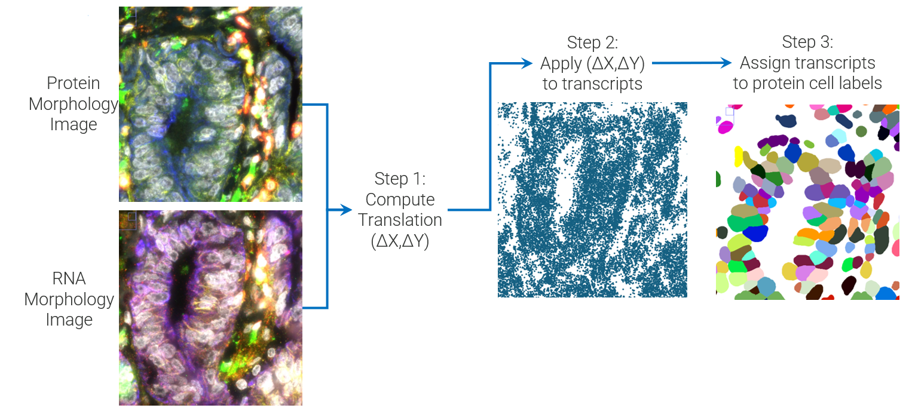
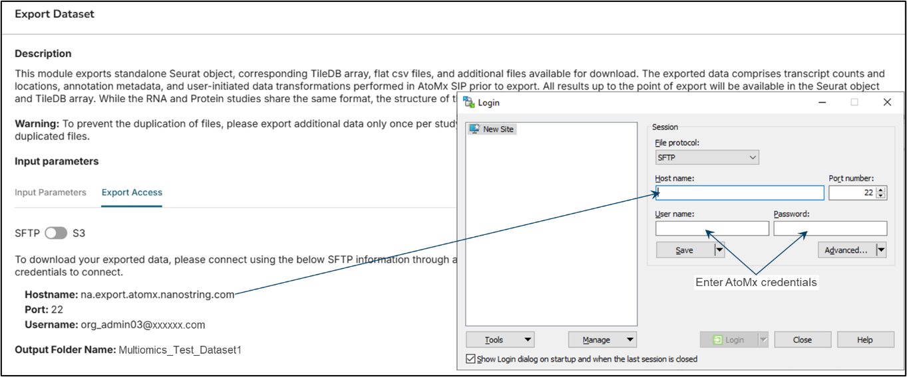
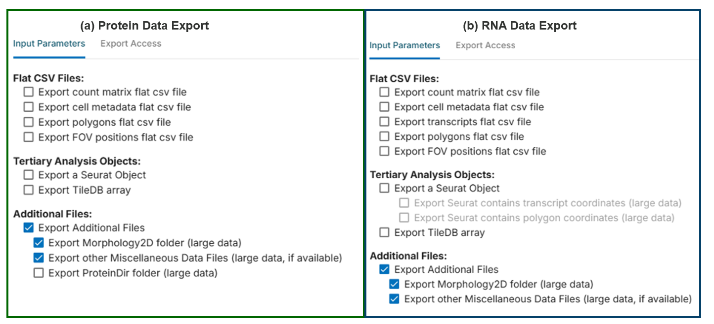

::: {.callout-note}
This post introduces a new tool for alignment of same cell CosMx<sup>&#174;</sup> multiomics data. Moving forward, we recommend that users employ the tool here instead of the tool introduced in our [previous post](../multiomics-alignment/index.qmd). 
:::

# CosMx Multiomics Data

CosMx<sup>&#174;</sup> SMI allows users to acquire protein and RNA data from the same tissue as consecutive experiments. These data are acquired as independent runs and therefore need to be aligned, post-acquisition, to combine them into a multiomic study. This alignment process brings the decoded RNA transcripts into the coordinate system of protein data. To accomplish this, we have developed a standalone alignment tool that can be used to align CosMx data exported from AtoMx<sup>&#174;</sup> SIP. The tool has a 3-step workflow represented in @fig-align-workflow:

Step 1: Align the RNA morphology fields of view (FOVs) to protein references.  

Step 2: Shift the RNA transcripts to the protein reference co-ordinates.  

Step 3: Assign the shifted RNA transcripts to the protein cell segmentation labels. 

```{r}
#| label: fig-align-workflow
#| fig-cap: "Schematic of the workings of the alignment tool"
#| fig-alt: "Four images showing alignment example"
#| out-width: "100%"
#| echo: false


```

Versions of the CosMx software, V.2.0.0 onwards, provided varying degrees of support for image-based alignment and transcript shifting during acquisition. However, assigning the RNA transcripts to protein cell labels (Step 3) is not yet performed on instrument or in AtoMx SIP. This tool will account for the various on-instrument versions of software and perform the necessary actions to combine protein and RNA analytes. 

The legacy `SMIMultiomicsAlignUI` workflow has been replaced by a standalone command-line interface tool, `SMIMultiomicsAlignCLI`. The tool is distributed as a published package for Windows, macOS, or Linux operating systems.  

:::{callout-note}
Like other items in our [CosMx Analysis Scratch Space](https://nanostring-biostats.github.io/CosMx-Analysis-Scratch-Space/about.html){target="_blank"},
the multiomics alignment tool presented here is experimental so the usual [caveats](https://nanostring-biostats.github.io/CosMx-Analysis-Scratch-Space/about.html){target="_blank"} and [license](https://nanostring-biostats.github.io/CosMx-Analysis-Scratch-Space/license.html){target="_blank"} applies.
:::

# Export CosMx Multiomics Data from AtoMx SIP

To export data from AtoMx SIP, you will need an sFTP application such as WinSCP. Launch the AtoMx Export function to obtain the AtoMx Hostname and Username (@fig-data-export, left). Use those credentials, with the AtoMx SIP user’s password, to open a WinSCP portal (@fig-data-export, right).

```{r}
#| label: fig-data-export
#| fig-cap: "Establishing export access between AtoMx SIP and WinSCP"
#| fig-alt: "Screenshot of AtoMx SIP export setup"
#| out-width: "100%"
#| echo: false

```


Next, export data from the protein experiment according to @fig-data-selection(a). Export data from the RNA experiment according to @fig-data-selection(b).

```{r}
#| label: fig-data-selection
#| fig-cap: "Data selection for (a) Protein and (b) RNA export from AtoMx SIP"
#| fig-alt: "Screenshot of data export selection from AtoMx SIP"
#| out-width: "100%"
#| echo: false

```


Check the exported data to confirm the following contents:

- Protein `CellStatsDir` folder and `Morphology2D` folder within 

- RNA `RunSummary` folder (obtained as part of Miscellaneous export) 

- RNA `CellStatsDir` folder and `Morphology2D` folder within 

- RNA `AnalysisResults` folder (obtained as part of Miscellaneous export) 


# Download and Use Alignment Tool

::: {.callout-note}
This multiomics alignment tool is actively and continuously under development in the RnD groups at
Bruker Spatial Biology. 
Please be aware that there may be bugs and that it has not gone through the regular
level of quality and testing. Our goal here is to bring the capabilities of multiomics
to CosMx SMI users as fast as possible.
For technical support, please contact support.spatial@bruker.com.
:::

Download and unzip the corresponding zip file for the OS of your choice from [here](https://github.com/Nanostring-Biostats/CosMx-Analysis-Scratch-Space/releases/tag/multiomics){target='_blank'}. Once unzipped, you will find a default `Multiomics_Alignment_Input.json` file alongside the executable, which you can edit in place, or you can create your own input JSON file anywhere. 


## Prepare the Input JSON 

You have two options: 

- **Use the default file**: Edit the `Multiomics_Alignment_Input.json` file included next to the executable with your paths. 

- **Create your own**: Create a new JSON file (any filename, e.g. `input.json`) anywhere on disk, using the same schema. 

 

Schema: 
```{json}
#| eval: false
#| echo: true
{ 
  "Protein_Morph2D": "/path/to/protein/Morph2D", 
  "Protein_Segmentation": "/path/to/protein/Segmentation", 
  "RNA_RunSummary": "/path/to/RNA_RunSummary", 
  "RNA_Morph2D": "/path/to/RNA/Morph2D", 
  "RNA_Transcripts": "/path/to/RNA/Transcripts" 
} 
```

 

Description of the input fields:  

- Protein_Morph2D - path to the exported protein morphology images dataset 

- Protein_Segmentation - path to the protein CellStatsDir

- RNA_RunSummary – path to the RunSummary folder  

- RNA_Morph2D - path to the exported RNA morphology images dataset 

- RNA_Transcripts - path to the RNA transcript directory 

## Run the Tool 

- Provide the full path to the CLI executable and the full path to the JSON file (the JSON file can have any name). 

- If you used the default `Multiomics_Alignment_Input.json` next to the executable, you could omit the JSON argument, and the tool will use it automatically. 

Windows:  

`<full\path\to>\SMIMultiomicsAlignCLI.exe <full\path\to>\input.json`

macOS/Linux: 

`<full/path/to>/SMIMultiomicsAlignCLI <full/path/to>/input.json`

## Tool Outputs 

If alignment is performed, a new folder called “AlignmentQC” is created within the RNA data folder structure and is populated with the outputs from the alignment. Occasionally, certain FOVs may be discarded from the multiomic analysis if they fail alignment. This can happen in cases of tissue peeling or significant cell loss. These FOVs, identified as outliers, are recorded in the “Alignment_Stats_Curated.csv” file and are excluded from the transcript shifting and re-assignment process. Refer to the table below for a list of AlignmentQC folder outputs and descriptions of the individual files.

| AlignmentQC Folder Outputs | Description of individual files |
|---------|:-----|
| Alignment_Stats.csv      | List of the paired Protein and RNA FOVs along with the computed XY shift (in pixels) between them.   |
| FOV_mask.TIF     | Binary Map of the FOV Locations.  |
| FOV_Cluster.TIF       | Visualization of FOV Clusters.    |
| Displacement_Vectors.png | Visualization of the FOV displacement with marked outliers. |
| Alignment_Stats_Curated.csv | Updated Stats file with outlier flags. |
| Stats_Report.txt | Reports the percentage of FOVs that were successfully aligned, along with a list of FOVs that failed alignment and were excluded from target re-assignment. |

: Folder outputs and descriptions {#tbl-alignment-qc-outputs tbl-colwidths="[40,60]"}

The final transcripts post alignment, shifting, and re-assignment will be saved in a folder with the suffix “_Shifted”. If only re-assignment was performed, then the transcripts will be saved in a folder with the suffix “_Reassigned”. 

For every instance of the tool being run a timestamped log file is created in the Log folder. This is useful for debugging any issues that might arise. 

# Conclusions 

After using the off-AtoMx alignment tool to apply protein cell segmentation boundaries and cell ID labels to the RNA data, you can use transcript-to-cell assignments found in the *_FOV#####__complete_code_cell_target_call_coords.csv per FOV files within the `AnalysisResults_Shifted` or `AnalysisResults_Reassigned` folder to continue analysis with the aligned RNA dataset. For an example of how to gather the aligned RNA transcript information into an updated gene x cell expression matrix, see the post [here](../aligned_rna_exp_matrix/index.qmd). These updated files can be used alongside the protein run flat files to create a new multiomic data object. It is important to note that all transcripts in the aligned RNA data will now reference the segmentation results and metadata from the protein run. 

If you prefer to integrate the aligned RNA data into an existing data object, you can do so by starting with the protein run object and either replacing the protein expression matrix with an aligned RNA matrix or appending the RNA data as an additional assay.

# Additional Troubleshooting and Error Explanations 

*"Error: the file \<path\> was not found."*

- The JSON path provided (or default `Multiomics_Alignment_Input.json` next to the executable) does not exist. 

- Double-check the filename and path passed as the first CLI argument. 

*"Error deserializing json: input was empty or invalid." / "Error deserializing json: \<message\>"*

- The JSON file is empty, malformed, or does not match the expected schema. 

- Verify the JSON is valid and field names match exactly: `Protein_Morph2D`, `RNA_Morph2D`, `RNA_RunSummary`, `Protein_Segmentation`, `RNA_Transcripts`. 

 

*"No ExptConfig.txt file found in the RNA_RunSummary directory"*

- The tool could not locate a `*_ExptConfig.txt` file in the provided `RNA_RunSummary` folder. 

- Verify `RNA_RunSummary` points to the correct RunSummary folder from the instrument, and that it contains the expected config file. 

 

*"Protein or RNA Morph2D images not provided. Please download the required images and run the tool again."*

- Occurs when on-instrument alignment was not detected and RNA morphology FOV alignment is required, but `Protein_Morph2D` or `RNA_Morph2D` paths are missing from the input JSON. 

- Download the required morphology image datasets and add their paths to the input JSON. 

 
*"Image registration failed. No shift file was produced."*

- Registration (`Align_RNA_To_Protein_Images`) ran but did not produce a valid shift file. 

- Check that `Protein_Morph2D` and `RNA_Morph2D` paths point to valid, complete datasets. 

 
*"Only Transcript Re-assignment failed."*

- Occurs in reassignment-only mode when `OnlyReassignRNATranscripts` returns false. 

- Verify `Protein_Segmentation` and `RNA_Transcripts` paths are correct and contain expected data. 

 
*"Failed to load required native OpenCV/Emgu library."*

- The tool could not load the native OpenCV dependency (`cvextern`) required for image processing. 

- Platform-specific checks: 

  - **Windows**: Ensure `cvextern.dll` is present next to the executable. 

  - **Linux**: Ensure `libcvextern.so` is present, and system dependencies (e.g., `libavcodec.so.60`) are installed. Run `install-linux-deps-ubuntu24.sh`. 

  - **macOS**: Ensure `libcvextern.dylib` is present and quarantine attribute has been removed from the publish folder (e.g., `xattr -d com.apple.quarantine <path>`). 

 

## Reassignment-only mode 

If image alignment (and therefore transcript shifting) has already been completed, you can run the CLI in reassignment-only mode. Use the following schema in your input JSON file: 
```{json}
#| eval: false
#| echo: true
{ 
  "Protein_Segmentation": "/path/to/protein/Segmentation", 
  "RNA_RunSummary": "/path/to/RNA_RunSummary", 
  "RNA_Transcripts": "/path/to/RNA/Transcripts" 
} 
```


For technical support, please contact support.spatial@bruker.com. 

::: {.callout-important}
Once the protein and RNA data are exported from AtoMx and modified through alignment, the updated data cannot be re-imported into AtoMx. As of AtoMx v2.4 and earlier, the platform retains only the original, pre-aligned data.
:::

